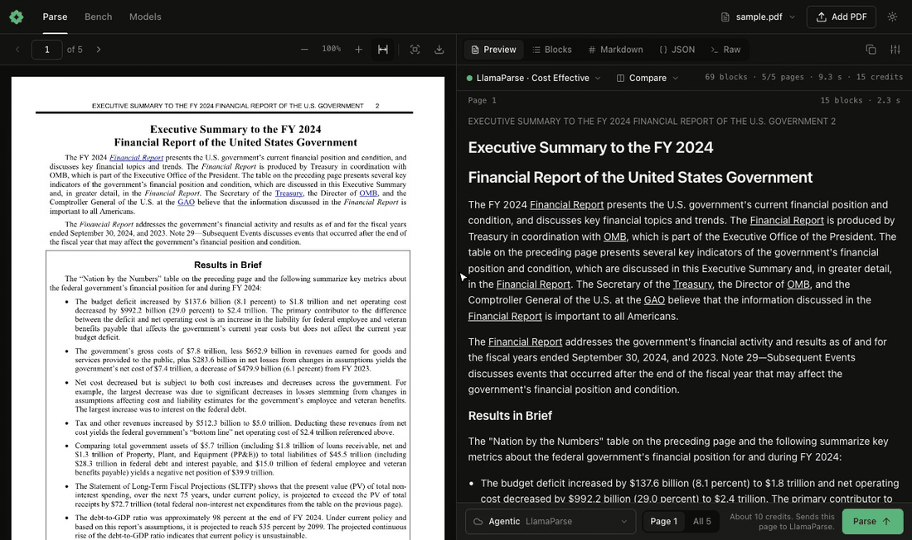

# okraPDF Agent Skills

Agent skills for working with PDFs. Most are bound to the [okraPDF API](https://api.okrapdf.com); **[pdf-parse-qa](skills/pdf-parse-qa/) is vendor-neutral** (bring your own parser - HuggingFace VLMs, Reducto, LlamaParse, Azure DI, anything).

Run this to open a local PDF parser dashboard. It needs no account:

```bash
npx okrapdf report.pdf
```



<sub>Netflix Q3 2025 shareholder letter, [Form 8-K, Exhibit 99.1](https://www.sec.gov/Archives/edgar/data/1065280/000106528025000404/ex991_q325.htm), parsed with Gemini 3 Flash. okraPDF has no connection with Netflix.</sub>

## Plugin: offline PDF parsing for agents

This repo is also an okraPDF plugin. It adds the `okrapdf` skill and a local MCP server, `npx okrapdf mcp`, to your agent. The server parses PDFs on your computer and returns every block with its page and box, so each answer can cite its source. It needs no account and no okraPDF server. Scans use a local model (Ollama, LM Studio) or your own API key.

| Host | Install |
| --- | --- |
| Codex and ChatGPT desktop | `codex plugin marketplace add okracomputer/skills`, then install **okraPDF** from the plugin directory |
| Claude Code | `/plugin marketplace add okracomputer/skills`, then `/plugin install okrapdf@okrapdf` |
| Cursor, VS Code, Kiro | Load this folder as an [Agent Plugin](https://github.com/agentplugins/agent-plugins-spec) (`plugin.json` + `mcp.json`) |
| Any MCP client | `{"mcpServers": {"okrapdf": {"command": "npx", "args": ["-y", "okrapdf@^0.17.0", "mcp"]}}}` |

Tools: `parse_pdf`, `find_in_pdf`, `list_models`, `open_dashboard`, `get_selected_block`.

## Skills

| JTBD | Skill | API key needed | What it teaches |
|------|-------|---|-----------------|
| Parse a PDF locally, side by side with hover source mapping | [okrapdf](skills/okrapdf/) | **none** — local models or your own key | `npx okrapdf` serves a dashboard on localhost: PDF and parsed blocks with two-way hover, local model detection (Ollama, LM Studio, vLLM, llama.cpp, MLX, Jan), your own API keys, and ParseBench scoring with the official evaluator. |
| Get a completion endpoint on a PDF, fast | [okra-curl](skills/okra-curl/) | okraPDF | `curl` cookbook for `POST /v1/documents` → OpenAI-compatible `POST /document/{id}/chat/completions`, structured extraction with `response_format`, exports, page images. The fastest path from "I have a PDF" to "I have an API." |
| Generate a designed PDF from an agent | [okra-create](skills/okra-create/) | okraPDF | `POST /render` (baked design system) + `POST /browser/html-to-pdf` (custom HTML cover) + `POST /codemode/run` (composed). One Worker, three modes. |
| Turn a collection into a navigable wiki | [okra-wiki](skills/okra-wiki/) | okraPDF | Collection export → per-doc synthesis → static site. Built on `GET /v1/collections/{id}/export`, `POST /v1/sandbox/run`, and the per-document chat-completion endpoint. |
| A/B test PDF parsers (Reducto vs LlamaParse vs Qwen2.5-VL vs Gemini Flash vs …) | [pdf-parse-qa](skills/pdf-parse-qa/) | **none** — BYO parser | Hosted block-by-block validator. Adapters for HuggingFace VLMs, Gemini, Reducto, okraPDF facets. Vote ↑↓ 1/2/3, export verdict JSON, compare per-label pass-rates. |

## Install

```bash
# All
npx skills add okracomputer/skills --all

# Just one
npx skills add okracomputer/skills --skill okrapdf
npx skills add okracomputer/skills --skill okra-curl
npx skills add okracomputer/skills --skill okra-create
npx skills add okracomputer/skills --skill okra-wiki
npx skills add okracomputer/skills --skill pdf-parse-qa

# For a specific agent (Claude Code, Cursor, OpenCode...)
npx skills add okracomputer/skills -a claude-code -g
```

Codex plugin marketplace install:

```bash
codex plugin marketplace add okracomputer/skills
```

Then open the Codex plugin directory and install **okraPDF** from the okraPDF marketplace. For local development:

```bash
codex plugin marketplace add ./
```

## Quick start

For the okraPDF-bound skills:
1. Get an API key at [okrapdf.com](https://okrapdf.com)
2. `export OKRA_API_KEY=okra_...`
3. Pick a JTBD above; the SKILL.md has copy-pasteable curl examples.

For the local dashboard, install the skill and tell your agent to open a PDF:

```bash
npx skills add okracomputer/skills --skill okrapdf
```

## Links

- [Documentation](https://docs.okrapdf.com)
- [API Reference](https://api.okrapdf.com)
- [SDK](https://github.com/okrapdf/sdk)
