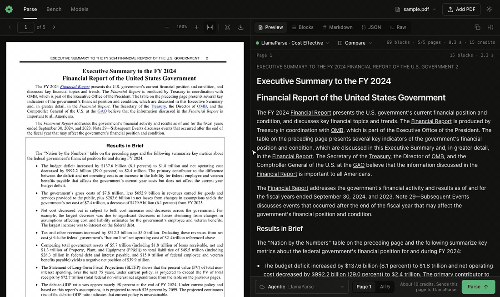

# okraPDF dashboard

Open a local PDF parser dashboard with one command. It needs no account.

```bash
npx okrapdf report.pdf
```



<sub>[Executive Summary to the FY 2024 Financial Report of the U.S. Government](https://fiscal.treasury.gov/system/files/files/reports-statements/financial-report/2024/executive-summary-2024.pdf), pages 2 to 6, parsed with LlamaParse Cost Effective through a person's own key.</sub>

- **Side by side:** the PDF is on the left, and the parsed output is on the right, in Preview, Blocks, Markdown, JSON, and Raw views. A hover on either side highlights the other, and the two panes scroll together.
- **Compare:** run two models on the same page and read them in columns beside the source.
- **Charts:** a vision model reads a chart into a data table, and the hover maps that table to the chart.
- **Local models:** the dashboard finds Ollama, LM Studio, vLLM, llama.cpp, MLX, and Jan. It also recommends models that fit your computer.
- **LlamaParse:** with your LlamaCloud key, the Agentic, Cost Effective, and Agentic Plus tiers run from the model menu, and the dashboard shows the credits that a run uses.
- **Your own keys:** it takes keys for Gemini, Anthropic, OpenAI, OpenRouter, and NVIDIA, or any OpenAI-compatible URL. Keys stay in the local server.
- **ParseBench:** runs use the ParseBench prompts word for word, and the official evaluator gives the scores.

Your document stays on your computer until you choose a cloud model. Then only the pages that you parse go to that provider.

Install the skill:

```bash
npx skills add okrapdf/skills --skill okrapdf
```

Agents read [SKILL.md](SKILL.md). Humans can run `npx okrapdf --help`.
